<div align="center">

# 🏠 VISTA

### VIT Integrated Smart Transit & Accommodation System

**A smart hostel and accommodation management platform for students, wardens, hostel staff and administrators.**


</div>

---

---

## 📖 About the project

Hostel life involves many small but important tasks: reporting a broken fan, getting a visitor approved,
asking for a meal when you are unwell, or sending a book to a friend in another hostel. **VISTA puts all of
these into one web application**, so students can request help easily and wardens and staff can manage and
track everything from a single dashboard.

VISTA's distinctive feature is **peer-to-peer inter-hostel delivery**: a student already going to another hostel
can carry a parcel for a flat **₹10** fee. The handover is confirmed securely with a **one-time password (OTP)**
or a **QR code + photo** check.

> ℹ️ All people, rooms and phone numbers in the demo data are fictional. Payments are **demo records only**
> (no real money moves), and the SOS feature is **not connected to real emergency services**.

---

## ✨ Key features

| Area | What users can do |
|---|---|
| 🔐 **Accounts & roles** | Student self-registration; admin creates warden / staff / admin accounts; secure login with role-based access (Student, Warden, Chief Warden, Staff, Admin) |
| 🛠️ **Complaints** | Raise electrical, plumbing, carpentry, washroom and water complaints; automatic forwarding to the right staff member; status tracking with full history; **automatic escalation to the chief warden** if unresolved (24 h / 48 h / 72 h by priority) |
| 🚪 **Visitors** | Students register visitors; wardens approve or reject with a reason; students are notified |
| 🍲 **Hostel services** | Sick-meal delivery to the room and room-cleaning requests, handled by mess and cleaning staff |
| 🚨 **Emergency SOS** | One tap (with confirmation) alerts wardens and security; acknowledge → resolve with timestamps |
| 📦 **Deliveries** | **P2P inter-hostel delivery (₹10)** with OTP or QR + photo handover; food and parcel booking at the hostel gate with courier name and gate OTP |
| 📢 **Communication** | Notice board, in-app notifications and one-to-one messaging |
| 🤝 **Community** | Lost & found, marketplace for books and items, notes sharing, private document vault, roommate finder, mess feedback, hostel map |
| 🏢 **Administration** | Manage hostels, blocks, rooms and room allocation; users; live reports with CSV export; audit log of every critical action |

---

## 📸 Screenshots

| Login | Student dashboard |
|---|---|
| 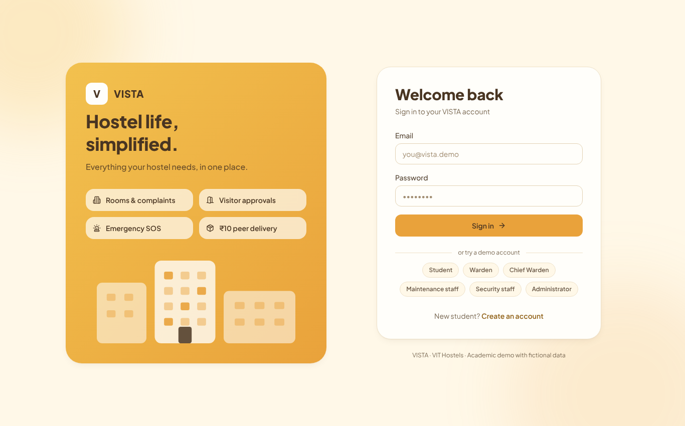 | 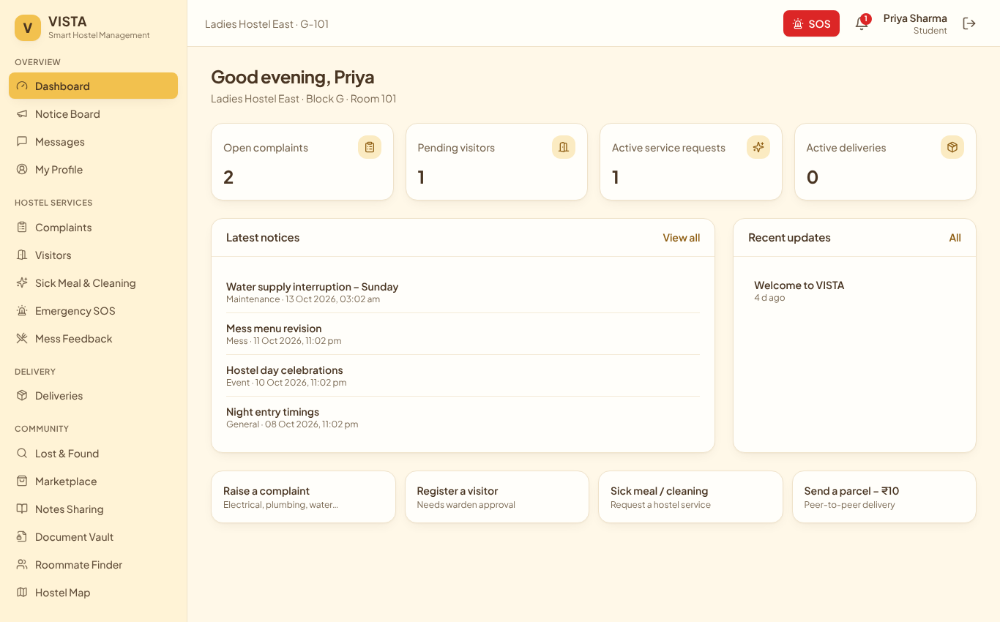 |

| Complaints | Emergency SOS |
|---|---|
| 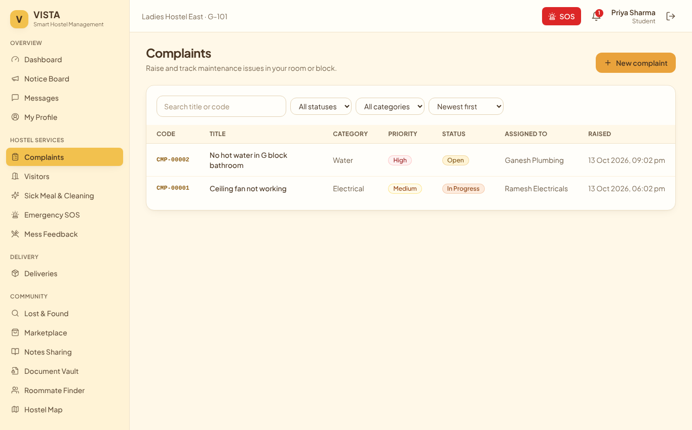 | 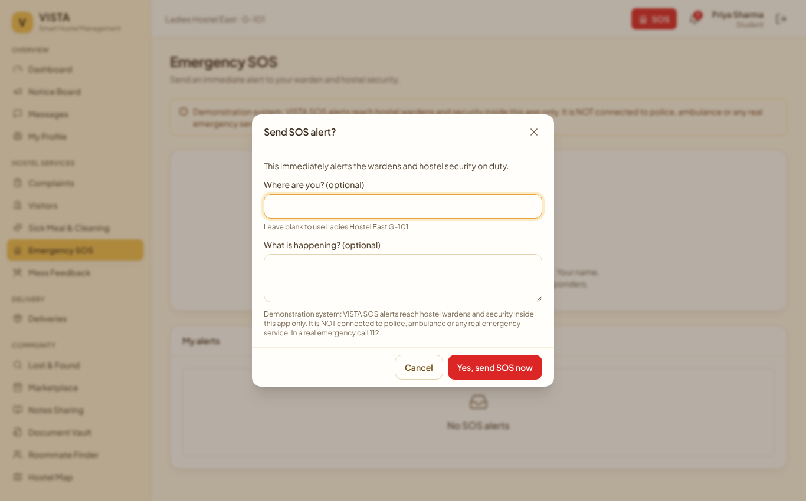 |

| Warden – visitor approvals | Admin – reports |
|---|---|
| 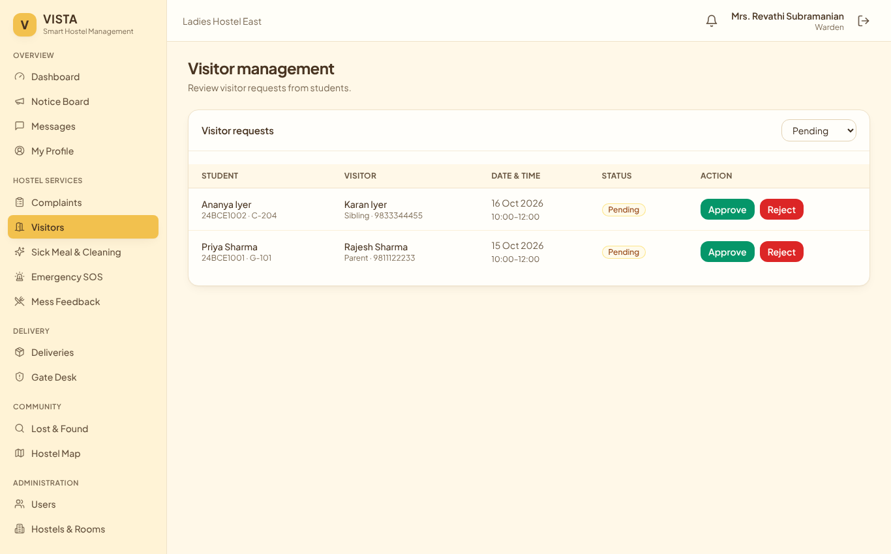 | 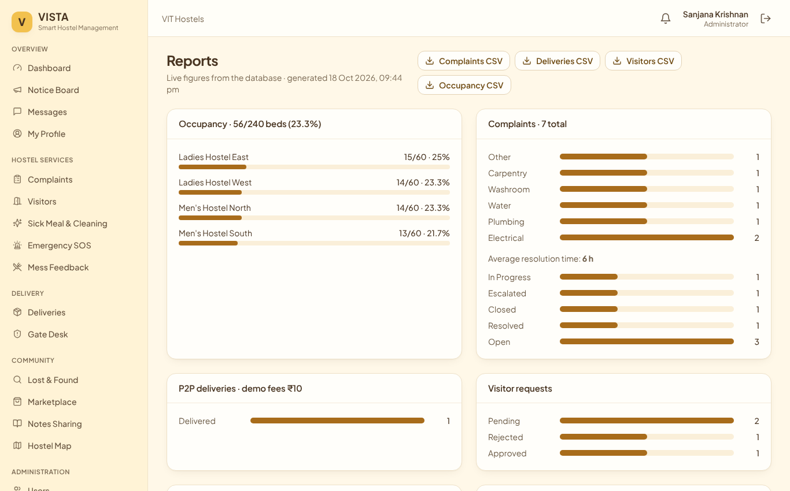 |

More screenshots, including mobile views, are in [`docs/screenshots`](docs/screenshots).

---

## 🏗️ System architecture

### 1. High-level architecture

VISTA follows a **three-tier architecture**: a web browser (presentation), a FastAPI application server
(business logic) and a relational database (data). In production the API server also serves the built
React website, so the whole application runs as **one web service plus one database**.

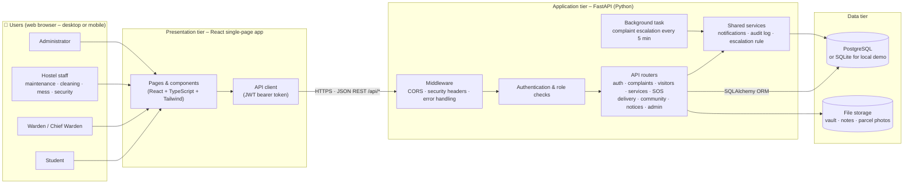

### 2. Layered (component) view

Each layer only talks to the layer below it, which keeps the code modular and easy to test.

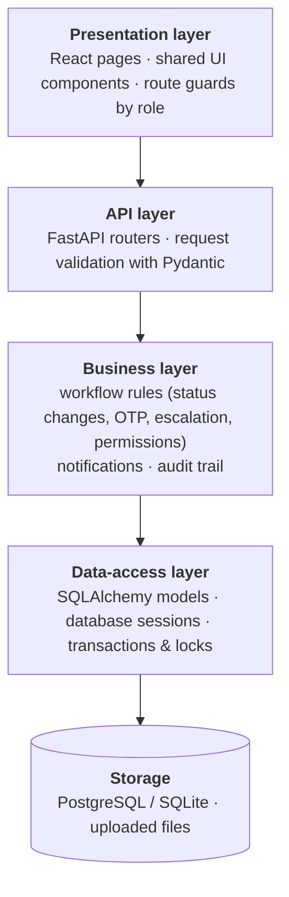

| Component | Responsibility | Main files |
|---|---|---|
| **Web app** | Screens for every role, forms with validation, dashboards | `frontend/src/pages/*`, `frontend/src/components/*` |
| **Application controller** | Single entry point `/api/*`, security headers, consistent JSON errors | `backend/app/main.py` |
| **Authentication & access control** | Registration, login, logout, JWT tokens, role checks, brute-force lockout | `routers/auth.py`, `security.py` |
| **Accommodation management** | Hostels, blocks, rooms, allocation, roommate finder, map | `routers/accommodation.py`, `routers/profile.py` |
| **Complaint management** | Raise, auto-forward, track, update, escalate | `routers/complaints.py`, `services.py` |
| **Visitor & service requests** | Visitor approval, sick meals, room cleaning | `routers/visitors.py`, `routers/service_requests.py` |
| **SOS & emergency** | Raise, notify, acknowledge, resolve | `routers/sos.py` |
| **Delivery management** | P2P delivery, demo payment, OTP / QR handover, gate bookings | `routers/delivery.py` |
| **Community services** | Lost & found, marketplace, notes, vault, mess feedback, file uploads | `routers/community.py` |
| **Notification & messaging** | Notices, notifications, messages | `routers/communication.py` |
| **Reports & audit** | Dashboards, reports, CSV export, audit log | `routers/admin.py` |
| **Data access** | Database models, sessions, seed data | `models.py`, `database.py`, `seed.py` |

### 3. Deployment architecture

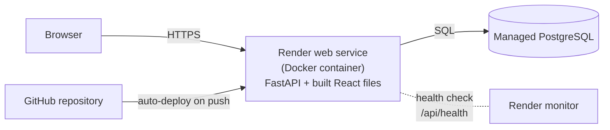

---

## 🔄 How the main workflows work

### Login with role check

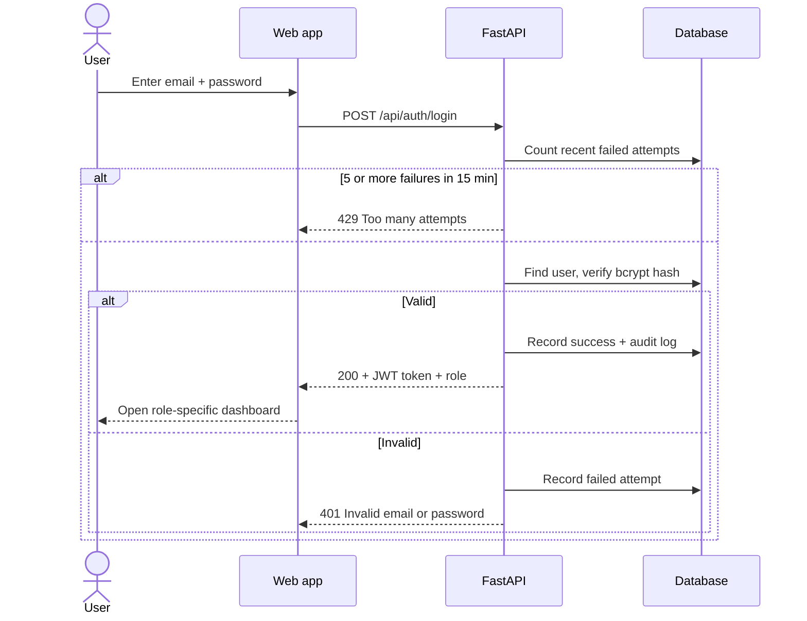

### Complaint life cycle (with escalation)

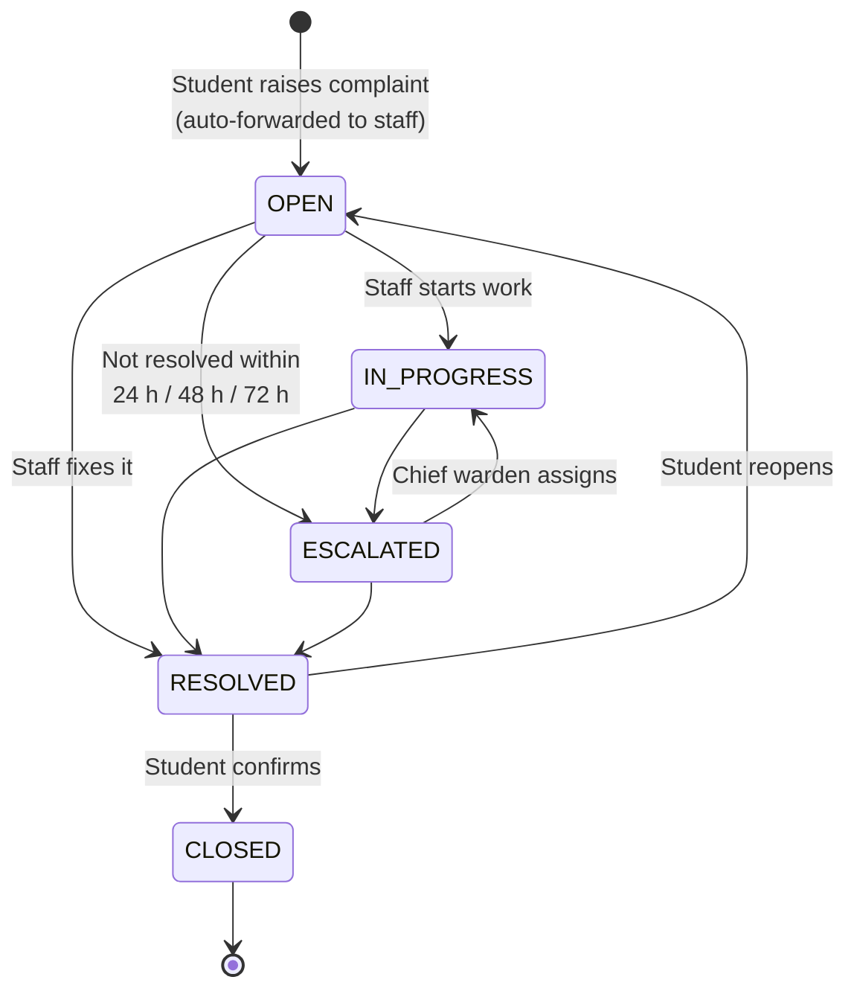

### Peer-to-peer delivery with OTP handover

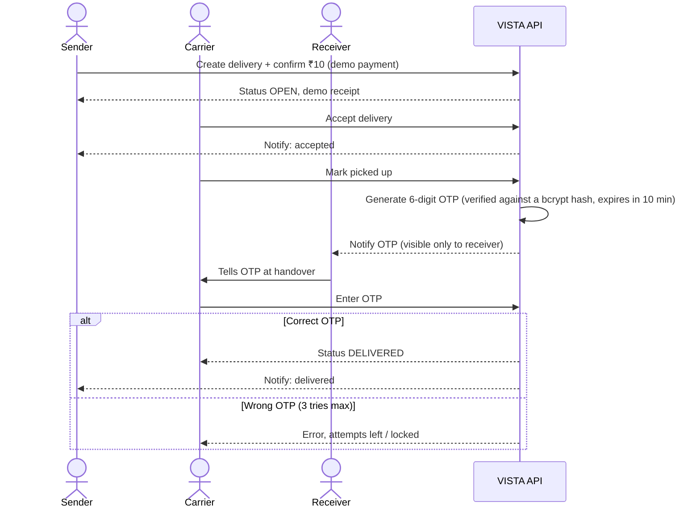

The same delivery can instead be confirmed by **scanning the receiver's QR code, uploading a parcel photo and
entering the receiver's name, registration number, room and block**, all of which must match the records.

---

## 🗄️ Data model

The database has 26 tables. The main entities and relationships are:

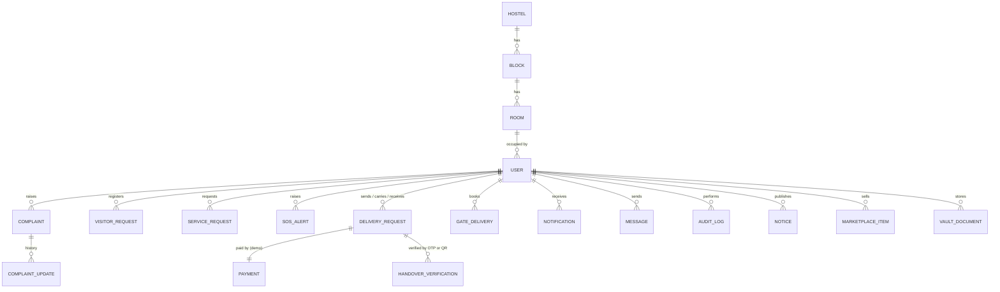

The full schema is in [`database/schema.sql`](database/schema.sql).

---

## 🧰 Technology stack

| Layer | Technology | Why |
|---|---|---|
| Frontend | React 18, TypeScript, Vite, Tailwind CSS, React Router | Fast, type-safe, consistent responsive design |
| Backend | FastAPI (Python 3.11+), Pydantic v2, SQLAlchemy 2 | Automatic input validation and API docs, clean data access |
| Database | PostgreSQL 16 (production) · SQLite (zero-setup local demo) | Reliable relational storage with transactions |
| Security | JWT tokens, bcrypt password hashing, role checks, rate limiting | Industry-standard authentication |
| Testing | Pytest, Vitest, Playwright + axe-core, k6 | API, unit, browser, accessibility and load testing |
| Reports | ReportLab (PDF), openpyxl (Excel) | Test reports generated from real results |
| Deployment | Docker, Render blueprint | One-click cloud deployment |

---

## 📂 Project structure

```
VISTA/
├── backend/                 FastAPI application
│   ├── app/
│   │   ├── main.py          app entry point, middleware, health check
│   │   ├── config.py        settings from environment variables
│   │   ├── database.py      database connection
│   │   ├── models.py        database tables (SQLAlchemy)
│   │   ├── security.py      passwords, tokens, role checks
│   │   ├── services.py      notifications, audit log, escalation rule
│   │   ├── seed.py          demo data
│   │   └── routers/         one file per module (auth, complaints, delivery, …)
│   ├── tests/               API, security and integrity tests (pytest)
│   └── requirements.txt
├── frontend/                React website
│   ├── src/pages/           one page per screen
│   ├── src/components/      layout, sidebar and shared UI components
│   └── dist/                pre-built website (served by the backend)
├── e2e/                     browser tests (Playwright)
├── perf/                    load test (k6)
├── database/schema.sql      database schema
├── scripts/                 test runner, report generator, backups
├── reports/                 testing reports (PDF, Excel, defect log)
├── docs/screenshots/        application screenshots
├── Dockerfile · render.yaml deployment files
└── .env.example             configuration template
```

---

## 🚀 Quick start – run it locally

**Requirement:** [Python 3.11 or newer](https://www.python.org/downloads/). On Windows, tick **"Add python.exe to PATH"** during installation.

```bash
# 1. Go to the backend folder
cd VISTA/backend

# 2. Install the required libraries (first time only)
pip install -r requirements.txt

# 3. Start the application
python -m uvicorn app.main:app --port 8000
```

Then open **http://localhost:8000** in your browser.

On the first start, VISTA automatically creates a local database file (`backend/vista.db`) with demo data, so
**no database installation is needed**. Keep the terminal open while using the app and press `Ctrl + C` to stop it.

<details>
<summary><b>Windows step-by-step</b></summary>

1. Open the `VISTA\backend` folder in File Explorer.
2. Click the address bar, type `cmd` and press **Enter**.
3. Run `pip install -r requirements.txt` (first time only).
4. Run `python -m uvicorn app.main:app --port 8000`.
5. Open **http://localhost:8000** in Chrome or Edge. Press `Ctrl + F5` if an old design appears.

</details>

<details>
<summary><b>Developer setup (PostgreSQL + live frontend editing)</b></summary>

```bash
# Create the PostgreSQL role and databases (needs a PostgreSQL superuser)
PGUSER=postgres ./scripts/setup_databases.sh

# Configure
cp .env.example .env        # set DATABASE_URL and JWT_SECRET

# Backend
cd backend && pip install -r requirements.txt
python -m app.seed          # tables + demo data (--reset to start over)
uvicorn app.main:app --reload --port 8000

# Frontend with hot reload (http://localhost:5173)
cd ../frontend && npm install && npm run dev
```

After changing the frontend, run `npm run build` so the backend serves the new version.

</details>

---

## 👤 Demo accounts

The login page has one-click buttons for these fictional accounts.

| Role | Email | Password |
|---|---|---|
| Student | `priya.sharma@vista.demo` | `Student@123` |
| Student | `rahul.verma@vista.demo` | `Student@123` |
| Warden | `warden.lh@vista.demo` | `Warden@123` |
| Chief Warden | `chief.warden@vista.demo` | `Warden@123` |
| Maintenance staff | `maint1@vista.demo` | `Staff@123` |
| Security staff | `security1@vista.demo` | `Staff@123` |
| Administrator | `admin@vista.demo` | `Admin@123` |

**Try the ₹10 delivery:** log in as Rahul → *Deliveries* → *Send an item* to `24BCE1001` → in a private window log in
as Arjun (`arjun.nair@vista.demo`) → *Available to carry* → Accept → Mark picked up → log in as Priya to see the OTP →
enter it as Arjun → **Delivered**.

> ⚠️ Remove or change the demo accounts before using VISTA with real data.

---

## 🧪 Testing

VISTA was tested with automated functional and non-functional test suites that run against the **real running
application**. Every result in the reports comes from an executed test.

| Test level | Total | Executed | Passed | Failed | Blocked | Not run | Pass rate |
|---|---|---|---|---|---|---|---|
| Functional (FT) | 43 | 43 | 43 | 0 | 0 | 0 | **100 %** |
| Non-functional (NFT) | 34 | 30 | 28 | 2 | 2 | 2 | **93.3 %** |

*Pass rate = passed ÷ executed. Blocked = Firefox / Safari could not be installed in the test environment.
Not run = needs a real user study or 30 days of live monitoring.*

| Suite | Result |
|---|---|
| Backend API & security tests (pytest) | 61 / 61 passed |
| Frontend unit tests (Vitest) | 14 / 14 passed |
| Browser end-to-end tests (Playwright, Chromium + mobile) | 23 / 23 passed |
| Accessibility scan (axe-core, WCAG 2.1 AA) | 0 serious issues |
| Load test, 300 concurrent users (k6) | 0 % errors, 1.4 s average response |

**Open findings:** response time grows under very high load on a small 2-CPU test machine (NFT-06), and
personal data is not encrypted at rest (NFT-34). Both are recorded in the defect log.

**Reports** (in [`reports/`](reports)): `Functional_Testing_Report.pdf`, `Non_Functional_Testing_Report.pdf`,
`Combined_Testing_Report.pdf`, editable Excel sheets, `defect-log.xlsx` and machine-readable `test-results.json` / `.xml`.

<details>
<summary><b>Run the tests yourself</b></summary>

```bash
cd backend && pytest                                   # API tests (needs PostgreSQL test DB)
cd frontend && npx vitest run                          # unit tests
cd e2e && npm install && npx playwright install chromium && npx playwright test
./scripts/run_all_tests.sh                             # everything + regenerate all reports
```

</details>

---

## ☁️ Deployment

VISTA includes a [`render.yaml`](render.yaml) blueprint for one-click deployment on **Render**:

1. Push this repository to GitHub.
2. On [render.com](https://render.com), choose **New → Blueprint** and select the repository.
3. Click **Apply**. Render creates a PostgreSQL database and the web service, generates a secret key and loads the demo data.
4. Open the URL shown on the service page (for example `https://vista-xxxx.onrender.com`).
5. Check `https://<your-url>/api/health`. It should return `"status":"ok"`.

> Free Render services sleep after inactivity (the first visit takes about a minute), and free databases are
> temporary. Open the site a few minutes before a demo.

Other options (Docker anywhere, Supabase database, separate Vercel frontend) are described in the comments of
`.env.example` and in `Dockerfile`.

---

## ⚙️ Configuration

All settings are environment variables. See [`.env.example`](.env.example) for the full list.

| Variable | Purpose | Default |
|---|---|---|
| `DATABASE_URL` | Database connection | local SQLite file `backend/vista.db` |
| `JWT_SECRET` | Secret for signing login tokens (**required in production**) | development-only value |
| `ENVIRONMENT` | `development` or `production` | `development` |
| `CORS_ORIGINS` | Allowed frontend addresses when hosted separately | `http://localhost:5173` |
| `ESCALATION_CHECK_SECONDS` | How often unresolved complaints are checked | `300` |
| `OTP_EXPIRY_MINUTES` / `OTP_MAX_ATTEMPTS` | Delivery OTP rules | `10` / `3` |

---

## 🔒 Security

- Passwords are stored only as **bcrypt hashes**. Delivery OTPs are verified against a bcrypt hash; the copy shown to the receiver is cleared once the OTP is used or expires.
- Every API request is checked for a **valid login token and the right role** on the server.
- **Brute-force protection:** 5 wrong passwords lock the account for 15 minutes.
- All input is validated; database access uses the ORM (protects against SQL injection).
- **Security headers:** Content-Security-Policy, X-Frame-Options, nosniff, HSTS in production.
- Uploads are checked by file content, limited to 2 MB and served only to permitted users.
- Every critical action (logins, approvals, SOS, deliveries) is recorded in the **audit log**.

---

## ⚠️ Known limitations

- Payments are **simulated** (no payment gateway); SOS alerts are **in-app only**.
- No SMS, e-mail or push notifications; notifications refresh every 30 seconds.
- Personal data is not encrypted at rest (planned: column-level encryption).
- Uploaded files are stored on the server's disk, so on free cloud hosting they are lost after a restart.
- Cross-browser testing covered Chrome / Chromium and mobile-screen emulation; Firefox and Safari were not tested.

---

## 👩‍💻 Team

| Name | Registration No. |
|---|---|
| Anwita Padhi | 24BYB0193 |
| Taposri Saha | 24BYB0183 |


---

<div align="center">

Made with ☕ for VIT hostels · Academic project – all data is fictional

</div>
